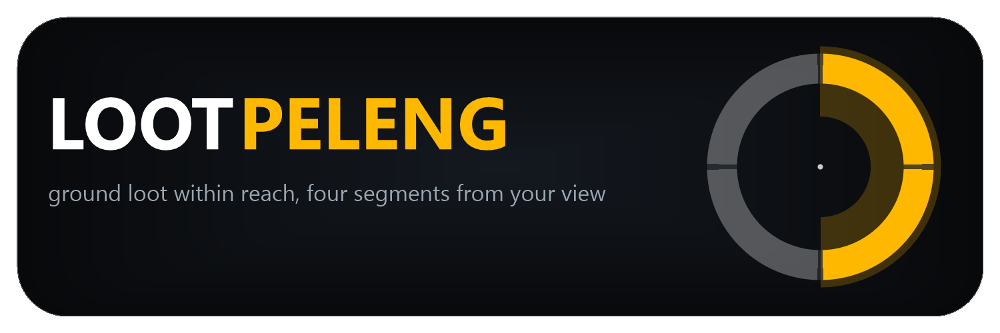

# Loot Peleng

A small SP Tushonka (4.1.6) client mod that draws a ring at the center of the screen when loose loot is close to your player.

The ring is split into four 90-degree segments relative to where you look. A segment lights up when loot sits in that direction — so at a glance you see which side of you the loot is on.

Loose loot means items lying on the ground: common items, quest items, dug-up stashes and bookmarks. Containers (drawers, crates, backpacks, bags, vests) and corpses are **not** counted — the ring points at things that already lie outside.

## Install

1. Drop `LootPeleng.dll` into `BepInEx/plugins`.
2. Start the game, load into a raid.

No dependencies beyond BepInEx and the Configuration Manager (for the in-game menu; the config file works on its own).

VirusTotal report for the release archive:
https://www.virustotal.com/gui/file/dee333ee11d264e246358c1d2bb7bbc8cedacae5632acbf43966931ed776b933

## What it does

- Scans a sphere around the player (default 2 m, every 200 ms — costs nothing on big maps)
- Counts `LootItem` objects: ground items, quest items, buried barrels (НПР), planted items
- Skips corpses (their loot is inside bags, not lying out)
- Optionally skips items you dropped yourself
- Lights the matching quarter of the center-screen ring; loot under your feet (inside 0.5 m) lights the whole ring

## Settings (F12)

| Section | Setting | Default | Description |
|---|---|---|---|
| General | `Enabled` | `true` | draw the ring |
| General | `RadiusMeters` | `2` | loot closer than this lights the ring (0.5–10) |
| General | `RingSizePx` | `58` | ring diameter in pixels (24–128) |
| General | `IgnoreOwnDrops` | `true` | items you dropped or threw do not light the ring |
| General | `BaseColor` | `#FFFFFF` | color of a segment with no loot in it |
| General | `BaseAlpha` | `0.3` | see-through of an inactive segment, 0 (invisible) to 1 (solid) |
| General | `ActiveColor` | `#FFB800` | color of a segment that has loot in it |
| General | `ActiveAlpha` | `1` | see-through of a lit segment, 0 (invisible) to 1 (solid) |
| About | `Repository` | link | project page on GitHub, kept in the config file for reference |

## Notes

- The ring is an overlay; it does not change any game UI
- Items inside closed containers have no separate ground object — the ring stays off until they are on the ground, this is by design
- Works in single-player raids only (the loot objects do not exist outside a raid)

## Build

```
dotnet build -c Release
```

The project references the game DLLs from `$(GamePath)` (default `d:\spt4`); pass `-p:GamePath=<your path>` if yours differs.
