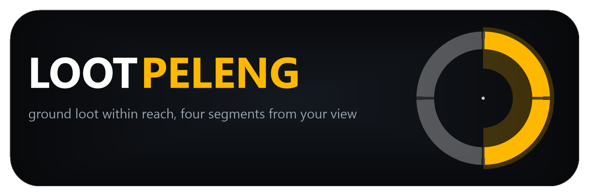

# Loot Peleng

A small SP Tushonka (4.1.6) client mod that draws a ring at the center of the screen when loose loot is close to your player.

The ring is split into four 90-degree segments relative to where you look. A segment lights up when loot sits in that direction — so at a glance you see which side of you the loot is on.

Loose loot means items lying on surfaces: the ground, tables, shelves and nightstands. Items inside containers (jackets, safes, crates, backpacks, vests), items worn or held by a body (the backpack, the rig, clothes, the weapon in its hands with everything mounted on it) are **not** counted. Quest items are always shown no matter where they sit — ground, tables, containers, safes, car cabins or corpses — and their ring pulses once a second in the active color.

## Install

1. Drop `LootPeleng.dll` into `BepInEx/plugins`.
2. Start the game, load into a raid.

No dependencies beyond BepInEx and the Configuration Manager (for the in-game menu; the config file works on its own).

VirusTotal report for the release archive:
https://www.virustotal.com/gui/file/2816d31cd2f8da81373533c642f1903c1b38243dddd57b82bdb1318b38efc9cc

## What it does

- Scans a sphere around the player (default 2 m, every 200 ms — costs nothing on big maps)
- Counts `LootItem` objects lying on surfaces: ground items, table items, buried barrels (НПР), planted items
- Quest items (`Item.QuestItem`) always light the whole ring, wherever they sit — containers, safes, cars, corpses included — and their segments pulse once a second in the active color
- Skips items inside `LootableContainer` (jackets, safes, crates, car cabins)
- Skips bodies entirely: the corpse itself, its equipment tree (backpack, rig, clothes) and the weapon it holds in its hands with all mounted mods
- Optionally skips items you dropped yourself
- Loot under your feet (inside 0.5 m) lights the whole ring

## Settings

All settings are changed in the in-game configuration menu (open it with the key set in the Configuration Manager) and persist between sessions.

| Section | Setting | Default | Description |
|---|---|---|---|
| General | `Enabled` | `true` | draw the ring |
| General | `RadiusMeters` | `2` | loot closer than this lights the ring (0.5–10) |
| General | `RingSizePx` | `58` | ring diameter in pixels (24–128) |
| General | `IgnoreOwnDrops` | `true` | items you dropped or threw do not light the ring |
| General | `BaseColor` | `#FFFFFF` | color of a segment with no loot in it |
| General | `BaseAlpha` | `0.3` | see-through of an inactive segment, 0 (invisible) to 1 (solid) |
| General | `ActiveColor` | `#FFB800` | color of a segment that has loot in it |
| General | `ActiveAlpha` | `1` | see-through of a lit segment, 0 (invisible) to 1 (solid) |
| About | `Repository` | link | project page on GitHub, kept in the config file for reference |

## Notes

- The ring is an overlay; it does not change any game UI
- Items inside closed containers have no separate ground object — the ring stays off until they are on the ground, this is by design
- Works in single-player raids only (the loot objects do not exist outside a raid)

## Build

```
dotnet build -c Release -p:GamePath="C:\path\to\your SPT folder"
```

`GamePath` is the game root that contains `BepInEx` and `EscapeFromTarkov.exe`. References resolve against the game DLLs, nothing is copied into the output.
